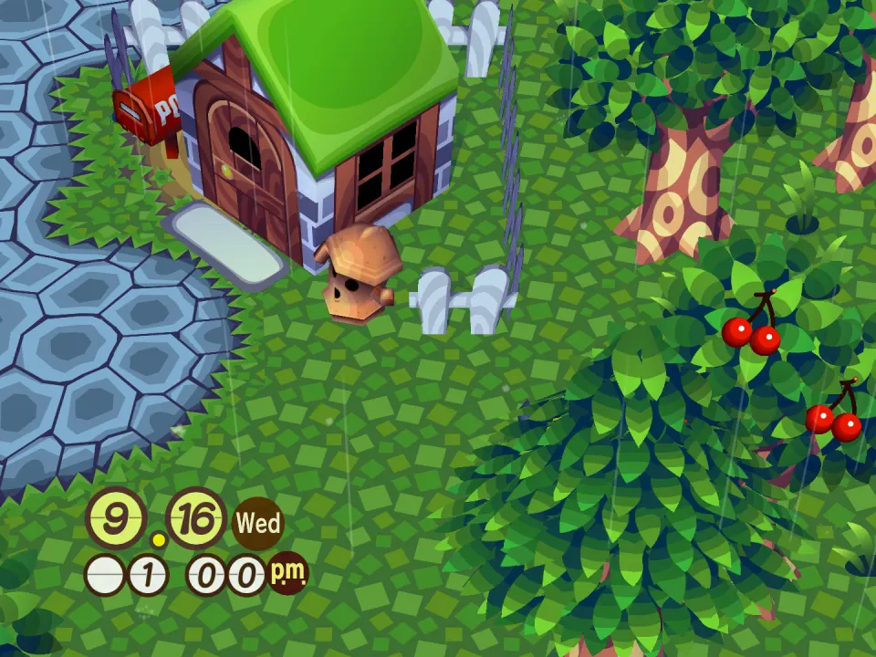
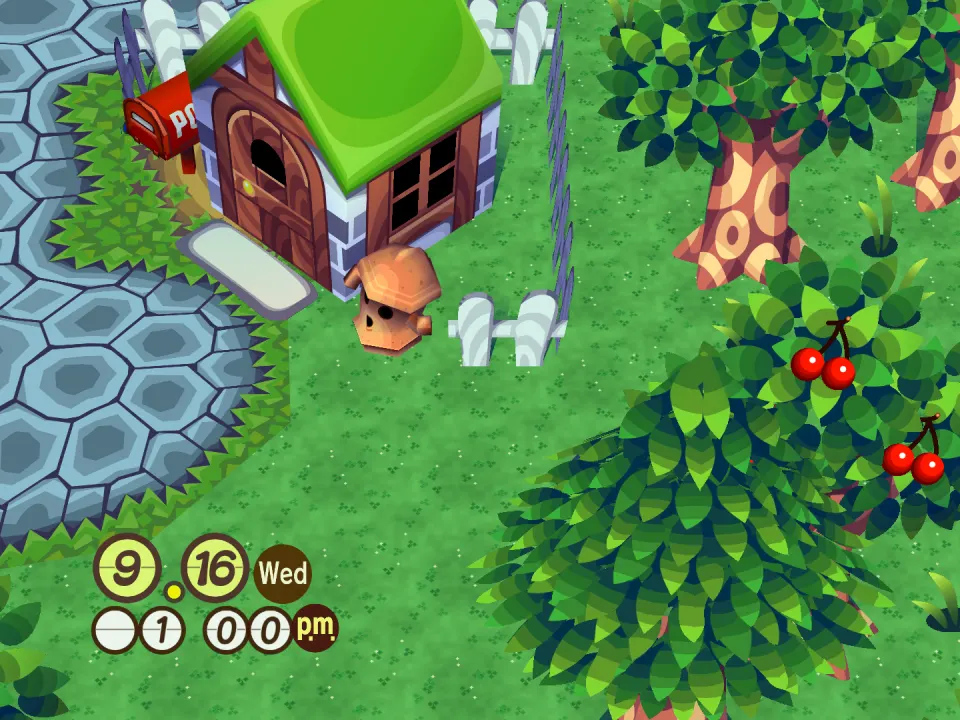
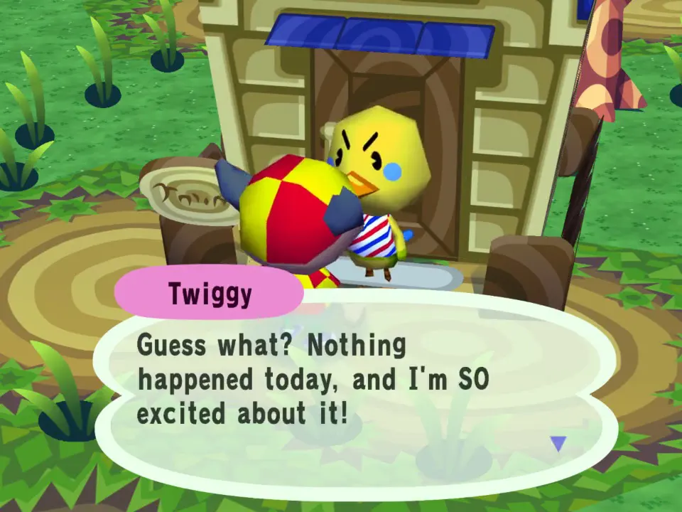

# Springtime Town

A Just you mod (`"scope": "client"`) in two halves, with no script:

- **The grass** (`textures/`): the town grass is our own drawing, seamless
  green ground with clover leaves and small white flowers.
- **The talk** (`talk.json`): new small talk in each villager's own
  personality's voice, some of it for the season, the time of day or the
  weather, and an evening goodbye after the topic.

Both are data. Neither changes what a visitor sees, so the mod is Just you.

## In the game

Before: a corner of town on a September afternoon, with no mods and the HD texture pack.

After: the same spot with Springtime Town installed. The grass is the mod's, drawn with clover and tiny white flowers; the trees, houses and paths are untouched.

Twiggy's own hello, then the menu after it. Choose "I'm bored!" to chat, and she picks a topic.

This time the topic is small talk, and her small talk is a line from the mod's peppy pool.

The film (click the picture): A walk past the houses on the mod's clover grass, then a chat with Twiggy: her hello, "I'm bored!", and a line from the mod as her small talk.

## The grass

The grass is one 128x128 uncompressed RGBA DDS picture, saved under every name
the game draws the grass with. The names say which in-game texture to replace,
and the pixels are our own.

The grass is six textures. The game draws each under several palettes, through
the seasons and the time of day. A file can name one texture and one palette:

    tex1_32x32_<texture>_<palette>_8.dds

Or it can put `$` in place of the palette, for that texture under any palette:

    tex1_32x32_<texture>_$_8.dds

Our grass is the same picture all year, so the mod has one `$` file per
texture. That is six files.

These three grass textures are drawn under nine palettes:

    textures: 626709d910129694 903adc6355e36f59 e96fecd242518c9f
    palettes: 193ca5974976e36e 20430b0042498b04 4f54e78515f0a185
              8910d24f6fbd5f83 8b8a1c2cacd60254 963dc45f18e13cf7
              b2e512f9c0fe88ad e7f9e59c09c5f9d0 f83e63a8b6cb47b7

And these three under three palettes:

    textures: 82f28ec4199a45be cfa57a6e6f966d11 e2ab673814e71af6
    palettes: 6d5ff5628ae85b42 ce63d23d746a058a d9eb32f9a8b17411

To change the grass for one stretch of the year or one time of day, add a file
named with that palette next to the `$` file. The file named for one palette
wins under that palette, and the `$` file still covers the rest.

With one file per palette, 36 files, the mod could change with every palette.
A `$` file is loaded once and shared, so it is the lighter choice when the
picture does not change.

The pictures were drawn by a small program, never copied from the game.

## The talk

Talk to a villager and choose to chat. After their hello they pick a topic,
the way they always do: a trade, a letter, a hint, or small talk. When they
pick small talk, the line can come from this mod.

`talk.json` holds line pools. Each personality has its own pool, and a few
more pools are kept to a moment: a normal villager has a line for spring, a
peppy one for the rain, a lazy one for the evening, a jock for winter, a
cranky one for the snow and a snooty one for a spring morning (`"season"`,
`"time"` and `"weather"`). A pool counts only at its moment, and among the
pools that count the game picks one line. A villager can say several of the
mod's lines in a day, and never the same one twice running.

A pool can instead name one villager (`"villager": "Bob"`), or nobody, which
means every villager, and can be said less often (`"chance": 30`; every time
it fits when left out). The most specific pools that fit a villager decide.

Every pool names its place in the talk. The small talk pools say
`"place": "topic"`: their lines stand in for the topic the villager picks
when you chat. The last pool says `"place": "after"`: on an evening chat,
half the time, any villager adds a line after their topic, as the talk's
last message. Its line is a list of two pages, each on a clean window. A
pool's place can also be `"before"` the hello, the `"hello"` itself or the
whole `"conversation"`.

No script is needed.

## Install

In Play AC Online, open the Mods tab. Springtime Town is in the mod list as an
official example: install it from there. Or download its ZIP from the
[cookbook](https://playaconline.com/modding/cookbook/) and add the file in the
Mods tab.

## Make your own

This repository is one mod, laid out the way the GitHub import wants it:
`mod.json` at the top, and a tag named for the version in `mod.json`.

1. Copy the repository to your own account.
2. Change `"id"` in `mod.json` to your own, like `yourname.springtime-town`.
   Ids that start with `example.` are kept for these examples, so the import
   refuses them.
3. Tag the commit with the version, like `v1.0.0`.
4. In the Mods tab, choose Import from GitHub and paste
   `github.com/<you>/<repository>@v1.0.0`.

To keep only one half, delete the other half's files and its lines in
`mod.json`, and `playac-mod check` tells you if anything still points at them.

The modding guide is at [playaconline.com/modding](https://playaconline.com/modding/).

`media/` holds the pictures and the film the cookbook shows, with their
captions in `media/media.json`. `.playac/screenshots/` holds the listing's
screenshots. The pack rule leaves the pictures, the film and the screenshots
out of the mod.

## License

MIT, see [LICENSE](LICENSE).
