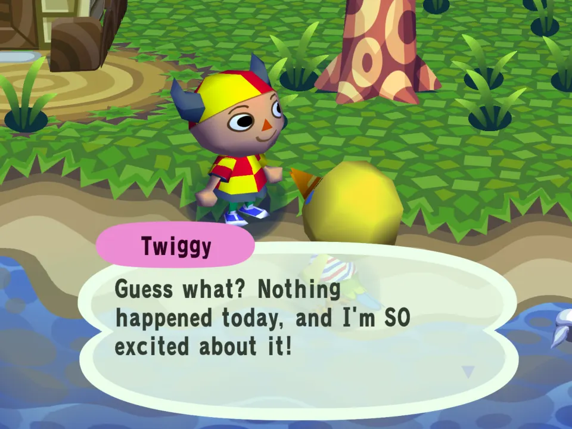
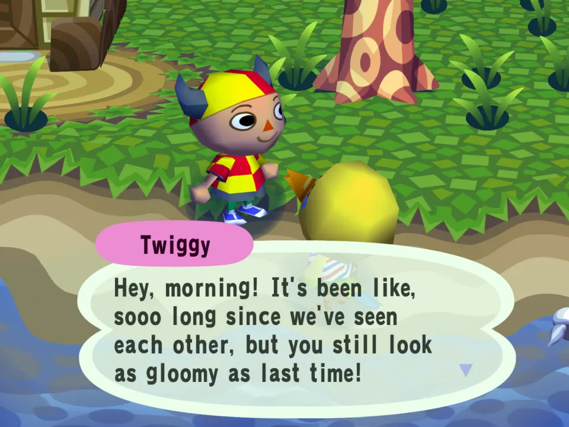

# Springtime Town

A Just you mod (`"scope": "client"`) in two halves, with no script:

- **The grass** (`textures/`): the town grass is our own drawing, seamless
  green ground with clover leaves and small white flowers.
- **The talk** (`talk.json`): on the first talk of the day, each villager says
  one new line in their own personality's voice, then their usual hello.

Both are data. Neither changes what a visitor sees, so the mod is Just you.

## In the game

Before: a corner of town on a September afternoon, with no mods and the HD texture pack.

After: the same spot with Springtime Town installed. The grass is the mod's, drawn with clover and tiny white flowers; the trees, houses and paths are untouched.

The first talk of the day opens on a new line from the mod's talk pools, picked for the villager's personality.

The next page is the villager's own hello: the mod's line comes first, and the game's conversation carries on as usual.

The film (click the picture): A walk past the houses on the mod's clover grass, then Twiggy's first talk of the day: the mod's line, then her own words. A second talk skips straight to her hello.

## The grass

The grass is one 128x128 uncompressed RGBA DDS picture, saved under every name
the game draws the grass with. The names say which in-game texture to replace,
and the pixels are our own.

The grass is six textures. The game draws each under several palettes, through
the seasons and the time of day. A file can name one texture and one palette:

    tex1_32x32_<texture>_<palette>_8.dds

Or it can put `$` in place of the palette, for that texture under any palette:

    tex1_32x32_<texture>_$_8.dds

Our grass is the same picture all year, so the mod has one `$` file per
texture. That is six files.

These three grass textures are drawn under nine palettes:

    textures: 626709d910129694 903adc6355e36f59 e96fecd242518c9f
    palettes: 193ca5974976e36e 20430b0042498b04 4f54e78515f0a185
              8910d24f6fbd5f83 8b8a1c2cacd60254 963dc45f18e13cf7
              b2e512f9c0fe88ad e7f9e59c09c5f9d0 f83e63a8b6cb47b7

And these three under three palettes:

    textures: 82f28ec4199a45be cfa57a6e6f966d11 e2ab673814e71af6
    palettes: 6d5ff5628ae85b42 ce63d23d746a058a d9eb32f9a8b17411

To change the grass for one stretch of the year or one time of day, add a file
named with that palette next to the `$` file. The file named for one palette
wins under that palette, and the `$` file still covers the rest.

With one file per palette, 36 files, the mod could change with every palette.
A `$` file is loaded once and shared, so it is the lighter choice when the
picture does not change.

The pictures were drawn by a small program, never copied from the game.

## The talk

`talk.json` holds line pools. Each personality has its own pool. On the first
ordinary talk of the day, a villager says one line from their personality's
pool. Then they say their usual hello and carry on as normal. Talk again the
same day and there is no new line.

A pool can instead name one villager (`"villager": "Bob"`), or nobody, which
means every villager. A pool can say a line only on some days
(`"chance": 40`). The most specific pools that match a villager decide.

The game picks the line. No script is needed.

## Install

In Play AC Online, open the Mods tab. Springtime Town is in the mod list as an
official example: install it from there. Or download its ZIP from the
[cookbook](https://playaconline.com/modding/cookbook/) and add the file in the
Mods tab.

## Make your own

This repository is one mod, laid out the way the GitHub import wants it:
`mod.json` at the top, and a tag named for the version in `mod.json`.

1. Copy the repository to your own account.
2. Change `"id"` in `mod.json` to your own, like `yourname.springtime-town`.
   Ids that start with `example.` are kept for these examples, so the import
   refuses them.
3. Tag the commit with the version, like `v1.0.0`.
4. In the Mods tab, choose Import from GitHub and paste
   `github.com/<you>/<repository>@v1.0.0`.

To keep only one half, delete the other half's files and its lines in
`mod.json`, and `playac-mod check` tells you if anything still points at them.

The modding guide is at [playaconline.com/modding](https://playaconline.com/modding/).

`media/` holds the pictures and the film the cookbook shows, with their
captions in `media/media.json`. `.playac/screenshots/` holds the listing's
screenshots. The pack rule leaves the pictures, the film and the screenshots
out of the mod.

## License

MIT, see [LICENSE](LICENSE).
